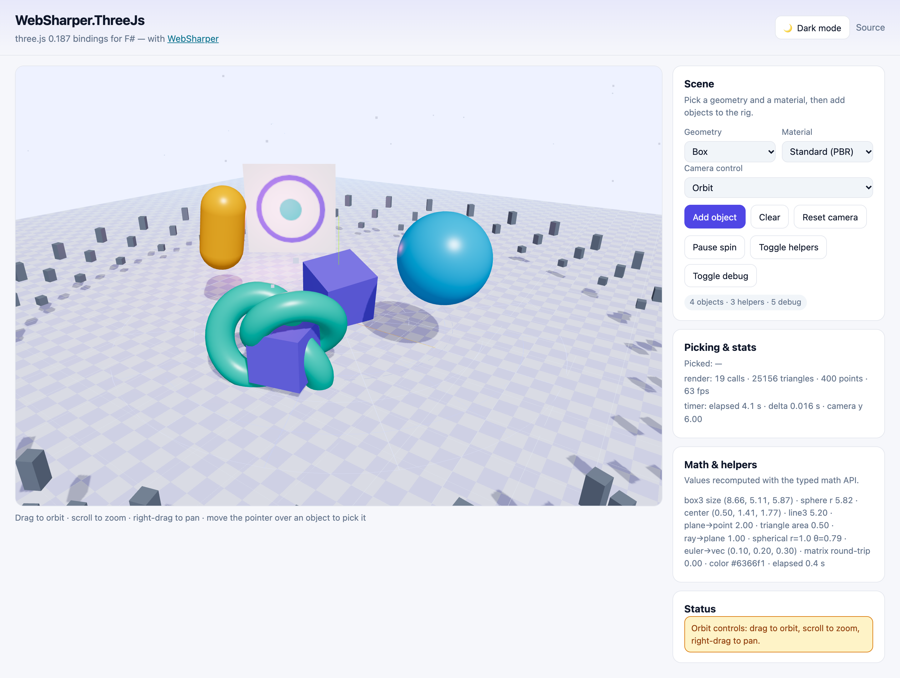

# WebSharper.ThreeJs

[](https://www.nuget.org/packages/WebSharper.ThreeJs)

WebSharper bindings for [three.js](https://threejs.org/) 0.187 — typed F# and C#
access to WebGL rendering, the scene graph, geometries, materials, lights,
textures, animation, raycasting and the addon controls (`OrbitControls`,
`TrackballControls`, `TransformControls`, …).

The binding is **npm based**: every class is a named import from the
[`three`](https://www.npmjs.com/package/three) package
(`import { Vector3 } from "three"`), the addons come from `three/addons/…`, and
your toolchain (esbuild in the sample) bundles them. There is no global `THREE`
object and no CDN `<script>` tag any more.

This repository contains:

| Project | Purpose |
| --- | --- |
| `WebSharper.ThreeJs` | The binding: ~160 classes and enums covering the math, core, camera, geometry, material, light, helper, renderer, loader and animation APIs, plus all nine addon controls (`OrbitControls`, `MapControls`, `TrackballControls`, `FlyControls`, `FirstPersonControls`, `PointerLockControls`, `ArcballControls`, `DragControls`, `TransformControls`). |
| `WebSharper.ThreeJs.Sample` | A WebSharper SPA (esbuild → `dist/`) with a live 3D scene, pointer picking, a camera-control switcher (orbit/map/trackball/fly/first-person/arcball/pointer-lock), a `TransformControls` gizmo and a `DragControls` mode, an instanced mesh, a hand-built `BufferGeometry` starfield, `DataTexture`/`TextureLoader` textures, an `AnimationMixer` clip and a light/dark theme. |

## Live demos

**Try it live:** [Open the sample in your browser](https://dotnet-websharper.github.io/threejs/)



The sample doubles as the binding's [test case](#running-the-test-case): it
renders a scene with `WebGLRenderer` (shadows, ACES tone mapping, sRGB output),
lets you switch between the addon camera controls (orbit, map, trackball, fly,
first person, arcball, pointer lock) and attaches a `TransformControls` gizmo or
a `DragControls` manipulator to the objects, adds objects from twelve geometries
and eight materials, picks them with `Raycaster` (the yellow `BoxHelper` follows
the hit and the readout shows its world-space `Box3`), drives one mesh with an
`AnimationMixer` clip, shows `InstancedMesh`, `Points`, a dashed `LineLoop`, the
grid/axes/polar/light/camera helpers, and recomputes a set of math results from
the live scene every tick. It is light-themed by default and has a light/dark
switcher (persisted in `localStorage`).

- **Sample (this repository):** <https://dotnet-websharper.github.io/threejs/>
- **Sample in the WebSharper samples gallery:** <https://websharper-samples.github.io/ThreeJS/>
- **Sample source in the gallery:** <https://github.com/websharper-samples/ThreeJS>
- **WebSharper:** <https://websharper.com>

## Install

```bash
dotnet add package WebSharper.ThreeJs
```

Or with Paket:

```fsharp
nuget WebSharper.ThreeJs
```

The package targets `netstandard2.0` and works with WebSharper 11 projects (a
`websharper100` branch tracks the WebSharper 10 line). It supports three.js
`>= 0.187.0 < 0.188.0`; three.js itself comes from npm (`three`), so the JS
bundle step must resolve it — WebSharper's SPA project does this automatically
when the sample/project has `<NpmDependencies>` and an esbuild (or Vite) step.

## Usage

All types live in the `WebSharper.ThreeJs` namespace.

### A rotating cube

```fsharp
open WebSharper
open WebSharper.JavaScript
open WebSharper.ThreeJs

[<JavaScript>]
let HelloCube (host: Dom.Element) =
    let width, height = host.ClientWidth, host.ClientHeight

    let renderer = WebGLRenderer(WebGLRendererOptions(Antialias = true))
    renderer.SetPixelRatio(JS.Window.DevicePixelRatio)
    renderer.SetSize(int width, int height, false)
    renderer.OutputColorSpace <- ColorSpace.SRGBColorSpace
    host.AppendChild(renderer.DomElement) |> ignore

    let scene = Scene()
    scene.Background <- Color("#eef2ff")

    let camera = PerspectiveCamera(50., width / height, 0.1, 100.)
    camera.Position.Set(0., 0., 5.)

    let cube =
        Mesh(
            BoxGeometry(1.5, 1.5, 1.5),
            MeshStandardMaterial(MeshStandardMaterialParameters(Color = "#6366f1", Roughness = 0.35)))

    scene.Add(cube) |> ignore
    scene.Add(AmbientLight("#ffffff", 1.2)) |> ignore
    scene.Add(DirectionalLight("#ffffff", 2.5)) |> ignore

    // `SetAnimationLoop` replaces a hand-written requestAnimationFrame helper.
    renderer.SetAnimationLoop(fun (_time: float) ->
        cube.Rotation.X <- cube.Rotation.X + 0.01
        cube.Rotation.Y <- cube.Rotation.Y + 0.02
        renderer.Render(scene, camera))
```

### Orbit controls and picking

```fsharp
let controls = OrbitControls(camera, renderer.DomElement)
controls.Target.Set(0., 1., 0.)
controls.EnableDamping <- true
controls.MinDistance <- 4.
controls.MaxDistance <- 26.

let raycaster = Raycaster()
raycaster.SetFromCamera(Vector2(0., 0.), camera)       // normalised device coordinates
let hits = raycaster.IntersectObjects([| (cube :> Object3D) |], true)
for hit in hits do
    printfn "%s at %.2f" hit.Object.Name hit.Distance
```

### The other addon controls

All nine controls from `three/addons/controls/` are bound, each imported from its
own module. They share the base `Controls` API (`Object`, `DomElement`,
`Enabled`, `Connect`, `Disconnect`, `Dispose`) and — except `OrbitControls`,
which types its `Update` as returning `bool` — expose `Update` and `Reset` where
three.js does. Call the one you chose from the render loop.

```fsharp
// OrbitControls and MapControls (also a plain orbit rig)
let map = MapControls(camera, renderer.DomElement)
map.EnableDamping <- true
map.ScreenSpacePanning <- true

// TrackballControls spins without keeping a fixed up vector.
let trackball = TrackballControls(camera, renderer.DomElement)
trackball.RotateSpeed <- 2.4
trackball.StaticMoving <- false
trackball.DynamicDampingFactor <- 0.12

// FlyControls / FirstPersonControls move the camera itself (WASD etc.).
let fly = FlyControls(camera, renderer.DomElement)
fly.MovementSpeed <- 6.
fly.DragToLook <- true

// PointerLockControls captures the pointer on a click.
let pointerLock = PointerLockControls(camera, renderer.DomElement)
pointerLock.PointerSpeed <- 1.2
// call pointerLock.Lock() from a user gesture (e.g. a click handler)

// ArcballControls takes the scene so it can draw its gizmos.
let arcball = ArcballControls(camera, renderer.DomElement, scene)
arcball.SetGizmosVisible(true)

// DragControls moves a set of objects in the camera plane.
let drag = DragControls([| (cube :> Object3D) |], camera, renderer.DomElement)
drag.Recursive <- false

// TransformControls is an object manipulator, not a camera control. Add its
// helper object to the scene and disable the camera control while dragging.
let transform = TransformControls(camera, renderer.DomElement)
transform.SetMode("translate")            // "translate" | "rotate" | "scale"
scene.Add(transform.GetHelper()) |> ignore
transform.Attach(cube) |> ignore
```

`TrackballControls`, `FlyControls` and `FirstPersonControls` need `Update` in the
render loop (`TrackballControls.Update()` takes no argument); `OrbitControls`,
`MapControls` and `ArcballControls` do too when damping/auto-rotate is on.

The control events are typed. Each control has an event-name enum and a payload
type, so `AddEventListener` resolves to a strongly typed overload:

```fsharp
transform.AddEventListener(TransformControlsEvent.DraggingChanged, fun e ->
    controls.Enabled <- not e.Value)      // e : TransformControlsEventPayload
    |> ignore

drag.AddEventListener(DragControlsEvent.DragStart, fun e ->
    printfn "dragging %s" e.Object.Name)  // e : DragControlsObjectEvent
    |> ignore

pointerLock.AddEventListener(PointerLockControlsEvent.Lock, fun _ -> ()) |> ignore
```

The `mouseButtons` / `touches` maps are typed too, via the `MouseButton` and
`TouchAction` enums, and the `keys` maps via `OrbitControlsKeys` /
`array<string>`:

```fsharp
controls.MouseButtons <- MouseButtons(LEFT = MouseButton.Rotate, RIGHT = MouseButton.Pan)
```

### Geometries, materials, lights

Geometries extend `BufferGeometry` (there is no `Geometry`/`Face3` any more),
materials extend `Material` and take a typed `*MaterialParameters` config:

```fsharp
let torus =
    Mesh(
        TorusKnotGeometry(0.9, 0.32, 160, 24, 2, 3),
        MeshPhysicalMaterial(
            MeshPhysicalMaterialParameters(
                Color = "#0ea5e9",
                Roughness = 0.18,
                Metalness = 0.2,
                Clearcoat = 1.,
                Transmission = 0.25)))

torus.CastShadow <- true
torus.ReceiveShadow <- true
scene.Add(torus) |> ignore
```

### Animation

```fsharp
let clip =
    AnimationClip(
        "bob", 4.,
        [| (NumberKeyframeTrack(".position[y]", [| 0.; 2.; 4. |], [| 0.8; 3.4; 0.8 |]) :> KeyframeTrack) |])

let mixer = AnimationMixer(mesh)
let action = mixer.ClipAction(clip)
action.SetLoop(LoopMode.LoopRepeat, 1).Play() |> ignore

// in the animation loop:
mixer.Update(deltaTime) |> ignore
```

### Textures without a network round-trip

```fsharp
// A checkerboard generated in code and uploaded as a DataTexture.
let size = 64
let data = Uint8Array(size * size * 4)
for y in 0 .. size - 1 do
    for x in 0 .. size - 1 do
        let i = (y * size + x) * 4
        let v = if (x / 8 + y / 8) % 2 = 0 then 206uy else 232uy
        data.Set(i, v); data.Set(i + 1, v); data.Set(i + 2, 255uy); data.Set(i + 3, 255uy)

let checker = DataTexture(data, size, size)
checker.WrapS <- Wrapping.RepeatWrapping
checker.WrapT <- Wrapping.RepeatWrapping
checker.Repeat.Set(12., 12.)
checker.ColorSpace <- ColorSpace.SRGBColorSpace
checker.NeedsUpdate <- true
```

`TextureLoader().Load(url, onLoad)` is bound as well (the sample loads a data URL).

## Notes on the API

- **Namespaces.** Everything is in `WebSharper.ThreeJs`: `Vector3`, `Mesh`,
  `Scene`, `PerspectiveCamera`, … — no `WebSharper.ThreeJs.THREE` namespace and
  no global `THREE` class. Constants live in typed enum classes, e.g.
  `Side.DoubleSide`, `Blending.AdditiveBlending`, `ShadowMapType.PCFShadowMap`,
  `ToneMapping.ACESFilmicToneMapping`, `Wrapping.RepeatWrapping`,
  `LoopMode.LoopRepeat`, `ColorSpace.SRGBColorSpace`.
- **Members that return `this`.** three.js chainable methods (`Set`, `Copy`,
  `Add`, `Update`, …) are typed as returning their own type, so chains work:
  `action.SetLoop(LoopMode.LoopRepeat, 1).Play()`.
- **Options are configs.** Constructors take typed `Pattern.Config` classes,
  e.g. `MeshStandardMaterialParameters`, `WebGLRendererOptions`,
  `RenderTargetOptions`, `RaycasterParameters`. Fields are optional exactly
  where three.js treats them as optional.
- **Nuance: colors.** Wherever three.js accepts a `ColorRepresentation` you can
  pass a `Color`, a hex `int`, or a CSS `string`. Color components (`Color.R`)
  are floats in the current API.
- **`Clock` is obsolete.** three.js 0.187 deprecates `Clock` in favour of
  `Timer`; the binding exposes both, `Clock` with an `Obsolete` message. The
  sample uses `Timer` (`Timer().Connect(JS.Document)`, `Update()`, `GetDelta()`,
  `GetElapsed()`).
- **`PCFSoftShadowMap` is gone.** It was removed in 0.187 (it silently fell back
  to `PCFShadowMap`); use `ShadowMapType.PCFShadowMap` or
  `ShadowMapType.VSMShadowMap`.
- **Addons** are imported from their `three/addons/…` module: the controls come
  from `three/addons/controls/<Name>.js`. No extra npm package is needed; the
  addons ship inside `three`. All nine controls are bound — see
  [The other addon controls](#the-other-addon-controls).
- **Renderer surface.** `OutputColorSpace`, `ToneMapping`,
  `ToneMappingExposure`, `ShadowMap` (`WebGLShadowMap`: `Enabled`, `Type`,
  `AutoUpdate`), `Info` (calls/triangles/points per frame), `SetAnimationLoop`,
  `SetPixelRatio`/`SetSize`, `Clear`, `SetRenderTarget` and the
  render-to-target helpers are typed.
- **Deliberately unbound.** `Geometry`/`Face3`, `CanvasRenderer`, `Projector`,
  `JSONLoader`, `SceneLoader`, `XHRLoader`, `ParticleSystem`, `MeshFaceMaterial`
  and `Spline` were removed upstream, so they are not in this binding. The
  shader/compute and TSL (WebGPU node) APIs are also out of scope.
- **Places where `obj` is kept on purpose.** The genuinely dynamic payloads are
  `*Material.UserData`/`Object3D.UserData` (user-owned records),
  `ShaderMaterial.Uniforms`/`Defines` (arbitrary uniform values), `Texture.Image`
  (upstream `any`), `WebGLInfo.Programs`, `WebGLRenderer.Xr`, and the
  `Compile`/`ComputeFrenetFrames`-style internals that three.js types as
  `any`/`Set`. Everything else is strongly typed — including
  `BufferGeometry.Attributes` (a `BufferAttributes` map with a string indexer),
  `GeometryGroup`, `LODLevel`, `FrenetFrames` and `WebGLCapabilities`.

### Upgrading from the 4.x binding

The 4.x package bound **three.js r67**: a global `THREE` object loaded from a CDN
`<script>`, `CanvasRenderer`, the `Geometry`/`Face3` model, `Projector`,
`JSONLoader`, `SceneLoader` and `three.min.js` as an embedded resource. None of
that exists in modern three.js. When moving to this binding:

1. Replace `new THREE.X(...)` with `X(...)` (and `open WebSharper.ThreeJs`).
2. Replace `Geometry` + `Face3` with `BufferGeometry` + `BufferAttribute`
   (`SetAttribute("position", BufferAttribute(positions, 3))`).
3. Replace `CanvasRenderer`/`Projector` with `WebGLRenderer`/`Raycaster`.
4. Replace `renderer.setSize` + `requestAnimationFrame` with
   `SetSize`/`SetAnimationLoop`.
5. Add an esbuild (or Vite) step to bundle the npm `three` package.

## Running the test case

The sample is a static SPA. Build it, then serve `dist/`:

```bash
dotnet tool restore
dotnet paket install
dotnet build WebSharper.ThreeJs.Sample/WebSharper.ThreeJs.Sample.fsproj -c Release

dotnet tool install -g dotnet-serve      # once
dotnet serve -d dist -p 5216
```

Then open <http://localhost:5216/>. (Port `5216` is the deterministic port used
for this sample; any free port works.)

What to try:

1. Move the pointer over the objects: the `BoxHelper` follows the hit and the
   readout shows the object name, distance and world-space bounding box.
2. Change the **Camera control** select: orbit, map, trackball, fly, first
   person, arcball and pointer lock swap the active camera control live;
   **Transform gizmo** attaches a `TransformControls` to an object (drag its
   arrows/rings to move, rotate and scale it), and **Drag objects** lets you
   grab the rig objects with `DragControls`.
3. Pick a geometry/material and press **Add object**; **Clear** empties the rig.
4. Toggle **Pause spin** to pause the `AnimationMixer` clip (the rig still
   turns), **Toggle helpers** for the grid/axes/polar helpers, **Toggle debug**
   for the light gizmos, the camera frustum and the `Box3Helper`.
5. Switch the theme; the choice is remembered in `localStorage`.

## Build from source

```bash
dotnet tool restore
dotnet paket install
dotnet build WebSharper.ThreeJs.sln -c Release
./build CI-Release          # the build stack's release target
```

`./build` is the encapsulated pair (`build.cmd` / `build.sh`) that also drives
the `WS-Package` and `CI-Tag`/`CI-Commit` targets used by
[build-script](https://github.com/dotnet-websharper/build-script).

## Pack

```bash
WSPackageFolder=/tmp/pkg dotnet fsi ./build.fsx -t WS-Package
```

This packs `WebSharper.ThreeJs` (`dll` + WebSharper metadata + `xml`) from
`nuget/WebSharper.ThreeJs.paket.template`.

## Deployment

`.github/workflows/ghpages.yml` restores Paket dependencies on `.NET 11`,
builds the sample in Release (which runs `npm install` + esbuild into `dist/`)
and publishes `dist/` to the `gh-pages` branch. It only deploys from `main`.

## Repository layout

| Path | Contents |
| --- | --- |
| `WebSharper.ThreeJs/` | The binding (`Main.fs` builds the `CodeModel.Assembly`). |
| `WebSharper.ThreeJs.Sample/` | The SPA: `Client.fs`, `index.html`, `site.css`, esbuild config. |
| `nuget/` | The Paket pack template. |
| `docs/sample.png` | Screenshot of the running sample (light theme). |
| `.github/workflows/ghpages.yml` | Build + GitHub Pages deploy. |
| `build.cmd` / `build.sh` / `build.fsx` | Build entry points. |

## License

Apache 2.0 — see [LICENSE.md](LICENSE.md). three.js itself is MIT licensed.